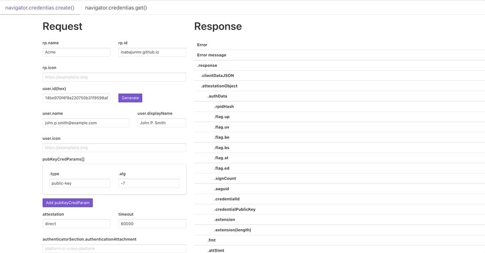

# webauthn-viewer

WebAuthn response viewer for learning.

https://inabajunmr.github.io/webauthn-viewer/



## Project setup

Use Node.js 20.19+ (20.x), 22.13+ (22.x), or 24+.

```
npm install
```

### Compiles and hot-reloads for development
```
npm run serve
```

### Compiles and minifies for production
```
npm run build
```

### Lint
```
npm run lint
```

## WebAuthn Level 4 updates

The **Sync WebAuthn Level 4** workflow checks the [latest W3C publication](https://www.w3.org/TR/webauthn-4/) on the first Monday of each month at 09:23 Japan time. It compares the IDL Index with the snapshot in `spec/webauthn-4.json`. Additions to existing option lists update the viewer and its GitHub Pages build. Changes to dictionaries, extension inputs, interfaces, and other IDL definitions open draft PRs for implementation review.

For draft PRs, the workflow can run the Codex GitHub Action with the IDL diff and the W3C publication text. Codex prepares a viewer implementation, tests, and the rebuilt `docs/` files. A separate job applies the proposed patch to the draft. Set the repository Actions secret `OPENAI_API_KEY` to enable this step. Without the secret, the specification draft is available for manual implementation.

The workflow runs lint, spec tests, and Chromium tests against the exact PR commit. Eligible candidate-list updates are squash-merged after CI, followed by a GitHub Pages build request. The repository's Actions setting **Allow GitHub Actions to create and approve pull requests** enables PR creation with the built-in token.

Use **Run workflow** to check the live spec on demand. Leave **publish** off for a change report in the run summary, or turn it on to process a real update. To run the checks locally:

```sh
npm run test:spec
npx playwright install chromium
npm run test:e2e
```
